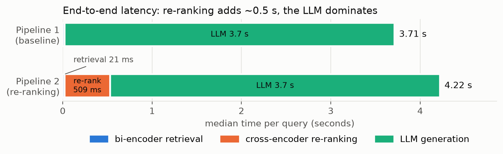
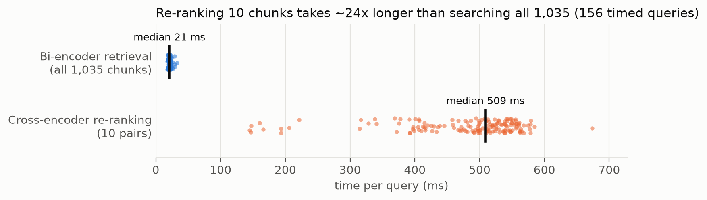

# Results appendix: Baseline vs. Re-Ranking RAG over the Constitution of India

All values below are computed from the saved runs in `failure_modes/results/` and the latency cells of `rag.ipynb`. Baseline = bi-encoder top 10 → top 3; re-ranked = the same 10 re-scored by the cross-encoder → top 3.

**Metric definitions** (relevance is article-level unless stated; a chunk is relevant if its article is in the expected list):

- **First rank**: rank of the first relevant chunk in the top 10 (– = not in the top 10)
- **Recall@3**: share of the expected articles that appear in the top 3
- **Precision@3**: share of the 3 chunks sent to the LLM that are relevant
- **RR / MRR**: 1 / rank of the first relevant chunk (0 if none); MRR is the mean over queries
- **nDCG@10**: every relevant article counts, discounted by log2(rank + 1), divided by the ideal ordering

## A. Failure categories tested

| Category | What it tests | Queries |
|---|---|---|
| Keyword trap / distractor | The query shares many words with the wrong passage - here mostly near-duplicate Union vs State articles (President vs Governor, Parliament vs State Legislature). | 10 |
| Synonyms / different terminology | The user's everyday words differ from the Constitution's legal wording ("remain silent" vs "compelled to be a witness against himself"). | 10 |
| Exceptions & corner cases | The general rule sits in one clause and the exception ("Nothing in this article shall…", "Provided that…") in another. | 10 |
| Negation & constraints | Questions about what is NOT allowed or who is excluded, where embeddings blur positive and negative statements. | 7 |
| Document-specific | Article-number lookups, omitted articles, cross-references ("the said clause") and section headings that are not part of the article text. | 9 |
| Out-of-corpus / hallucination checks | The answer is not in the article text (court doctrines, footnote-only amendment history, Schedules); the correct behaviour is to refuse. | 6 |
| **Total** | | **52** |

## B. Queries and per-query metrics (baseline → re-ranked)

▲ / ▼ = better / worse after re-ranking.

### Keyword trap / distractor

| Query | Expected | First rank | Recall@3 | Precision@3 | RR | nDCG@10 |
|---|---|---|---|---|---|---|
| Can the Governor pardon a person sentenced to death? | 72, 161 | #1 → #1 | 1.00 → 1.00 | 0.67 → 0.67 | 1.00 → 1.00 | 1.00 → 1.00 |
| What is the minimum age to become President of India? | 58 | #1 → #1 | 1.00 → 1.00 | 0.33 → 0.33 | 1.00 → 1.00 | 1.00 → 1.00 |
| What is the minimum age to become a member of the Lok Sabha? | 84 | #1 → #1 | 1.00 → 1.00 | 0.33 → 0.33 | 1.00 → 1.00 | 1.00 → 1.00 |
| Who can issue Ordinances when the legislature is not in session? | 123, 213 | #1 → #1 | 0.50 → 0.50 | 0.67 → 0.33 ▼ | 1.00 → 1.00 | 0.85 → 0.92 ▲ |
| Which court can issue a writ of habeas corpus? | 32, 226 | #1 → #2 | 1.00 → 1.00 | 0.67 → 0.67 | 1.00 → 0.50 ▼ | 0.92 → 0.69 ▼ |
| What is the maximum gap allowed between two sessions of Parliament? | 85 | #1 → #1 | 1.00 → 1.00 | 0.33 → 0.33 | 1.00 → 1.00 | 1.00 → 1.00 |
| Can the President be a member of Parliament? | 59 | #3 → #1 | 1.00 → 1.00 | 0.33 → 0.33 | 0.33 → 1.00 ▲ | 0.50 → 1.00 ▲ |
| Who appoints the judges of a High Court? | 217 | #5 → #1 | 0.00 → 1.00 ▲ | 0.00 → 0.33 ▲ | 0.20 → 1.00 ▲ | 0.39 → 1.00 ▲ |
| Who is the supreme commander of the Defence Forces? | 53 | #4 → #1 | 0.00 → 1.00 ▲ | 0.00 → 0.33 ▲ | 0.25 → 1.00 ▲ | 0.43 → 1.00 ▲ |
| What is a Money Bill? | 110 | #1 → #3 | 1.00 → 1.00 | 0.67 → 0.33 ▼ | 1.00 → 0.33 ▼ | 1.00 → 0.63 ▼ |

### Synonyms / different terminology

| Query | Expected | First rank | Recall@3 | Precision@3 | RR | nDCG@10 |
|---|---|---|---|---|---|---|
| Does an accused person have the right to remain silent? | 20 | #6 → #2 | 0.00 → 1.00 ▲ | 0.00 → 0.33 ▲ | 0.17 → 0.50 ▲ | 0.39 → 0.63 ▲ |
| Can the government ban a peaceful protest? | 19 | – → – | 0.00 → 0.00 | 0.00 → 0.00 | 0.00 → 0.00 | 0.00 → 0.00 |
| Is child labour allowed in India? | 24 | #1 → #1 | 1.00 → 1.00 | 0.33 → 0.33 | 1.00 → 1.00 | 1.00 → 1.00 |
| Is human trafficking illegal? | 23 | #1 → #1 | 1.00 → 1.00 | 0.33 → 0.33 | 1.00 → 1.00 | 1.00 → 1.00 |
| Can the President be sued in court? | 361 | – → – | 0.00 → 0.00 | 0.00 → 0.00 | 0.00 → 0.00 | 0.00 → 0.00 |
| How can the President be removed from office? | 56, 61 | #2 → #3 | 0.50 → 0.50 | 0.33 → 0.33 | 0.50 → 0.33 ▼ | 0.62 → 0.57 ▼ |
| At what age can a citizen vote? | 326 | #1 → #1 | 1.00 → 1.00 | 0.33 → 0.33 | 1.00 → 1.00 | 1.00 → 1.00 |
| What is the national language of India? | 343 | #2 → #3 | 1.00 → 1.00 | 0.33 → 0.33 | 0.50 → 0.33 ▼ | 0.63 → 0.50 ▼ |
| Is caste discrimination illegal? | 15, 17 | #1 → #1 | 0.50 → 0.50 | 1.00 → 1.00 | 1.00 → 1.00 | 0.61 → 0.61 |
| Is the President immune from court proceedings? | 361 | #5 → #1 | 0.00 → 1.00 ▲ | 0.00 → 0.67 ▲ | 0.20 → 1.00 ▲ | 0.39 → 1.00 ▲ |

### Exceptions & corner cases

| Query | Expected | First rank | Recall@3 | Precision@3 | RR | nDCG@10 |
|---|---|---|---|---|---|---|
| Can the State make special laws only for women? | 15 | #1 → #1 | 1.00 → 1.00 | 0.67 → 1.00 ▲ | 1.00 → 1.00 | 1.00 → 1.00 |
| Can the State reserve government jobs for backward classes? | 16 | #10 → #10 | 0.00 → 0.00 | 0.00 → 0.00 | 0.10 → 0.10 | 0.39 → 0.39 |
| Can fundamental rights be suspended during an emergency? | 359 | #1 → #1 | 1.00 → 1.00 | 1.00 → 1.00 | 1.00 → 1.00 | 1.00 → 1.00 |
| Can the right to life be suspended during an emergency? | 359, 21 | #1 → #1 | 0.50 → 0.50 | 0.67 → 1.00 ▲ | 1.00 → 1.00 | 0.92 → 0.88 ▼ |
| Does Article 13 invalidate constitutional amendments that violate fundamental rights? | 13 | #1 → #1 | 1.00 → 1.00 | 1.00 → 1.00 | 1.00 → 1.00 | 1.00 → 1.00 |
| Can a person who is not an MP be appointed as a Union Minister? | 75 | #1 → #2 | 1.00 → 1.00 | 0.33 → 0.33 | 1.00 → 0.50 ▼ | 1.00 → 0.63 ▼ |
| Can a person who is not an MLA become a State Minister? | 164 | #1 → #1 | 1.00 → 1.00 | 0.67 → 0.67 | 1.00 → 1.00 | 1.00 → 1.00 |
| Can citizens be stopped from moving freely in Scheduled Tribe areas? | 19 | – → – | 0.00 → 0.00 | 0.00 → 0.00 | 0.00 → 0.00 | 0.00 → 0.00 |
| On what grounds can free speech be restricted? | 19 | #1 → #2 | 1.00 → 1.00 | 0.33 → 0.33 | 1.00 → 0.50 ▼ | 1.00 → 0.63 ▼ |
| Can the Vice-President act as President? | 65 | #4 → #1 | 0.00 → 1.00 ▲ | 0.00 → 0.33 ▲ | 0.25 → 1.00 ▲ | 0.50 → 1.00 ▲ |

### Negation & constraints

| Query | Expected | First rank | Recall@3 | Precision@3 | RR | nDCG@10 |
|---|---|---|---|---|---|---|
| Who is NOT protected by the arrest and detention safeguards? | 22 | #1 → #1 | 1.00 → 1.00 | 1.00 → 1.00 | 1.00 → 1.00 | 1.00 → 1.00 |
| Within how many hours must an arrested person be produced before a magistrate? | 22 | #1 → #1 | 1.00 → 1.00 | 1.00 → 1.00 | 1.00 → 1.00 | 1.00 → 1.00 |
| What can the Rajya Sabha NOT do with a Money Bill? | 109 | – → – | 0.00 → 0.00 | 0.00 → 0.00 | 0.00 → 0.00 | 0.00 → 0.00 |
| Which titles is the State NOT allowed to confer? | 18 | #1 → #1 | 1.00 → 1.00 | 0.33 → 0.33 | 1.00 → 1.00 | 1.00 → 1.00 |
| Can a non-citizen holding a public office accept a foreign title without permission? | 18 | #1 → #1 | 1.00 → 1.00 | 0.33 → 0.33 | 1.00 → 1.00 | 1.00 → 1.00 |
| Is religious instruction allowed in government-funded schools? | 28 | #1 → #1 | 1.00 → 1.00 | 0.33 → 0.33 | 1.00 → 1.00 | 1.00 → 1.00 |
| Can the Council of States be dissolved? | 83 | #6 → #1 | 0.00 → 1.00 ▲ | 0.00 → 0.33 ▲ | 0.17 → 1.00 ▲ | 0.50 → 1.00 ▲ |

### Document-specific

| Query | Expected | First rank | Recall@3 | Precision@3 | RR | nDCG@10 |
|---|---|---|---|---|---|---|
| What does Article 21 say? | 21 | #1 → #1 | 1.00 → 1.00 | 0.33 → 0.33 | 1.00 → 1.00 | 1.00 → 1.00 |
| What is Article 356 about? | 356 | #1 → #1 | 1.00 → 1.00 | 0.67 → 1.00 ▲ | 1.00 → 1.00 | 1.00 → 1.00 |
| What is Article 370? | 370 | #2 → #1 | 1.00 → 1.00 | 0.33 → 0.67 ▲ | 0.50 → 1.00 ▲ | 0.63 → 1.00 ▲ |
| Is the right to property a fundamental right? | 300A | – → – | 0.00 → 0.00 | 0.00 → 0.00 | 0.00 → 0.00 | 0.00 → 0.00 |
| What does Article 31 say? | 31 | – → – | 0.00 → 0.00 | 0.00 → 0.00 | 0.00 → 0.00 | 0.00 → 0.00 |
| Can peaceful assembly be restricted in the interest of public order? | 19 | – → – | 0.00 → 0.00 | 0.00 → 0.00 | 0.00 → 0.00 | 0.00 → 0.00 |
| What does the right to equality say? | 14 | #1 → #3 | 1.00 → 1.00 | 0.33 → 0.33 | 1.00 → 0.33 ▼ | 1.00 → 0.63 ▼ |
| What are the fundamental duties of citizens? | 51A | #1 → #1 | 1.00 → 1.00 | 0.33 → 0.67 ▲ | 1.00 → 1.00 | 1.00 → 1.00 |
| What are the Directive Principles of State Policy? | 36, 37 | #1 → #2 | 0.50 → 0.50 | 0.33 → 0.33 | 1.00 → 0.50 ▼ | 0.61 → 0.39 ▼ |

### Out-of-corpus / hallucination checks

| Query | Expected | First rank | Recall@3 | Precision@3 | RR | nDCG@10 |
|---|---|---|---|---|---|---|
| Is the right to privacy a fundamental right? | none (should refuse) | n/a | n/a | n/a | n/a | n/a |
| When was the right to education added to the Constitution? | 21A | #1 → #1 | 1.00 → 1.00 | 0.33 → 0.33 | 1.00 → 1.00 | 1.00 → 1.00 |
| Which amendment inserted Article 21A? | 21A | – → – | 0.00 → 0.00 | 0.00 → 0.00 | 0.00 → 0.00 | 0.00 → 0.00 |
| What is the basic structure doctrine? | none (should refuse) | n/a | n/a | n/a | n/a | n/a |
| What is the definition of an illiterate person in the Constitution? | none (should refuse) | n/a | n/a | n/a | n/a | n/a |
| What does the First Schedule list? | none (should refuse) | n/a | n/a | n/a | n/a | n/a |

## C. Mean metrics per category (baseline → re-ranked)

Only queries with an expected article are averaged.

| Category | n | Recall@3 | Precision@3 | MRR | nDCG@10 |
|---|---|---|---|---|---|
| Keyword trap / distractor | 10 | 0.75 → 0.95 | 0.40 → 0.40 | 0.78 → 0.88 | 0.81 → 0.92 |
| Synonyms / different terminology | 10 | 0.50 → 0.70 | 0.27 → 0.37 | 0.54 → 0.62 | 0.56 → 0.63 |
| Exceptions & corner cases | 10 | 0.65 → 0.75 | 0.47 → 0.57 | 0.73 → 0.71 | 0.78 → 0.75 |
| Negation & constraints | 7 | 0.71 → 0.86 | 0.43 → 0.48 | 0.74 → 0.86 | 0.79 → 0.86 |
| Document-specific | 9 | 0.61 → 0.61 | 0.26 → 0.37 | 0.61 → 0.54 | 0.58 → 0.56 |
| Out-of-corpus / hallucination checks | 2 | 0.50 → 0.50 | 0.17 → 0.17 | 0.50 → 0.50 | 0.50 → 0.50 |
| **All** | **48** | **0.64 → 0.76** | **0.35 → 0.42** | **0.67 → 0.71** | **0.69 → 0.73** |

| Hit rate | Baseline | Re-ranked |
|---|---|---|
| Hit@1 | 0.60 | 0.62 |
| Hit@3 | 0.69 | 0.81 |
| Hit@10 | 0.83 | 0.83 |

Hit@10 is identical by construction: re-ranking only reorders the same 10 chunks.

First relevant chunk after re-ranking: **8 moved up, 8 moved down, 24 unchanged**, 8 never in the top 10.

## D. Selected rescue cases (clause-level relevance)

These cases were chosen *because* re-ranking promoted the answering clause, so their averages are biased in favour of re-ranking; they illustrate the mechanism rather than overall performance.

| Query | Answering chunks | Baseline top 3 | Re-ranked top 3 | Recall@3 | RR | nDCG@10 |
|---|---|---|---|---|---|---|
| What is Article 370? | 370_0 #8→#2 | 232_0, 370_3, 145_2 | 370_3, 370_0, 344_5 | 0.00 → 1.00 | 0.12 → 0.50 | 0.32 → 0.63 |
| Can the Vice-President act as President? | 65_0 #4→#1 | 66_3, 71_0, 66_1 | 65_0, 64_0, 66_1 | 0.00 → 1.00 | 0.25 → 1.00 | 0.43 → 1.00 |
| Who appoints the judges of a High Court? | 217_0 #7→#1 | 233_0, 224A_0, 224_0 | 217_0, 216_0, 229_0 | 0.00 → 1.00 | 0.14 → 1.00 | 0.33 → 1.00 |
| Who is the supreme commander of the Defence Forces? | 53_0 #4→#1 | 148_0, 33_0, 76_0 | 53_0, 33_0, 146_0 | 0.00 → 1.00 | 0.25 → 1.00 | 0.43 → 1.00 |
| Can the Council of States be dissolved? | 83_0 #6→#1 | 172_0, 80_0, 80_1 | 83_0, 172_0, 90_0 | 0.00 → 1.00 | 0.17 → 1.00 | 0.36 → 1.00 |
| Does an accused person have the right to remain silent? | 20_0 #6→#2 | 311_1, 22_5, 22_0 | 22_0, 20_0, 22_4 | 0.00 → 1.00 | 0.17 → 0.50 | 0.36 → 0.63 |
| Is caste discrimination illegal? | 15_0 #6→#1, 15_1 #10→#3 | 15_3, 15_4, 15_6 | 15_0, 15_3, 15_1 | 0.00 → 1.00 | 0.17 → 1.00 | 0.40 → 0.92 |
| Is the President immune from court proceedings? | 361_1 #7→#1, 361_0 #5→#2 | 124_4, 128_0, 356_1 | 361_1, 361_0, 124_4 | 0.00 → 1.00 | 0.20 → 1.00 | 0.44 → 1.00 |
| **Mean** | | | | **0.00 → 1.00** | **0.18 → 0.88** | **0.38 → 0.90** |

Answers (same prompt and model for both pipelines):

**What is Article 370?**

- *Answer 1 (baseline):* Based on the provided context, Article 370 contains "Temporary provisions with respect to the State of Jammu and Kashmir" (Article 370). Under clause (3) of Article 370, the President may declare by public notification that the article shall cease to be operative, or shall be operative only with specified exceptions and modifications from a date he specifies, provided that the recommendation of the Legislative Assembly of the State is necessary before the President issues such a notification (Article 370(3)).
- *Answer 2 (re-ranked):* Based on the provided context, Article 370 outlines "Temporary provisions with respect to the State of Jammu and Kashmir" [Article 370]. Its main provisions include: • **Non-applicability of Article 238:** The provisions of Article 238 shall not apply to the State of Jammu and Kashmir [Article 370(1)(a)]. • **Limitation on Parliament's Legislative Power:** Parliament's power to make laws for Jammu and Kashmir is limited to matters in the Union List and Concurrent List that the President declares—in consultation with the State Government—correspond to the Instrument of Accession [Article 370(1)(b)(i)], as well as other matters in those Lists specified by the President with the concurrence of the State Government [Article 370(1)(b)(ii)]. • **Definition of State Government:** The "Government of the State" is defined as the person recognized by the President as the Maharaja of Jammu and Kashmir acting on advice [Article 370(1)]. • **Cessation or Modification:** The President may declare by public notification that Article 370 shall cease to be operative or shall be operative only with specified exceptions and modifications, provided that the recommendation of the Legislative Assembly of the State is necessary before issuing such a notification [Article 370(3)].

**Can the Vice-President act as President?**

- *Answer 1 (baseline):* The provided context does not answer this.
- *Answer 2 (re-ranked):* Yes, the Vice-President can act as President under the following conditions: • In the event of a vacancy in the office of the President due to death, resignation, removal, or otherwise, the Vice-President shall act as President until a newly elected President enters upon his office (Article 65(1)). • When the President is unable to discharge his functions owing to absence, illness, or any other cause, the Vice-President shall discharge his functions until the President resumes his duties (Article 65(2)).

**Who appoints the judges of a High Court?**

- *Answer 1 (baseline):* Based on the provided context, the appointment of specific types of High Court judges is as follows: • **Additional and Acting Judges:** The President, in consultation with the National Judicial Appointments Commission, appoints additional and acting Judges of a High Court [Article 224(1), Article 224(2)]. • **Retired Judges sitting as Judges:** The National Judicial Appointments Commission, on a reference made to it by the Chief Justice of a High Court and with the previous consent of the President, may request a retired judge to sit and act as a Judge of a High Court [Article 224A]. The provided context does not contain information regarding who appoints permanent or regular High Court judges generally.
- *Answer 2 (re-ranked):* Based on the provided context, the judges of a High Court are appointed by the President (Article 216, Article 217(1)). Specifically, Article 217(1) states that every Judge of a High Court shall be appointed by the President by warrant under his hand and seal. Additionally, Article 216 mentions that a High Court consists of a Chief Justice and such other Judges as the President may deem necessary to appoint.

**Who is the supreme commander of the Defence Forces?**

- *Answer 1 (baseline):* The provided context does not answer this.
- *Answer 2 (re-ranked):* The supreme command of the Defence Forces of the Union is vested in the President (Article 53(2)).

**Can the Council of States be dissolved?**

- *Answer 1 (baseline):* The provided context does not answer this.
- *Answer 2 (re-ranked):* No, the Council of States cannot be dissolved. According to Article 83(1), the Council of States shall not be subject to dissolution, but as nearly as possible one-third of its members shall retire on the expiration of every second year.

**Does an accused person have the right to remain silent?**

- *Answer 1 (baseline):* The provided context does not answer this.
- *Answer 2 (re-ranked):* The provided context does not answer this.

**Is caste discrimination illegal?**

- *Answer 1 (baseline):* Based on the provided context, Article 15 provides for the "Prohibition of discrimination on grounds of religion, race, caste, sex or place of birth" [Article 15]. However, the context specifies that Article 15 does not prevent the State from making special provisions for the advancement of socially and educationally backward classes of citizens, the Scheduled Castes, or the Scheduled Tribes, including provisions related to admission to educational institutions [Article 15(4), Article 15(5)].
- *Answer 2 (re-ranked):* Yes, caste discrimination is prohibited under the Constitution of India: • **Article 15(1)** states that the State shall not discriminate against any citizen on grounds only of religion, race, caste, sex, place of birth, or any of them. • **Article 15(2)** provides that no citizen shall, on grounds only of religion, race, caste, sex, place of birth, or any of them, be subjected to any disability, liability, restriction, or condition regarding: • Access to shops, public restaurants, hotels, and places of public entertainment [Article 15(2)(a)]. • The use of wells, tanks, bathing ghats, roads, and places of public resort maintained wholly or partly out of State funds or dedicated to the use of the general public [Article 15(2)(b)].

**Is the President immune from court proceedings?**

- *Answer 1 (baseline):* The provided context does not answer this.
- *Answer 2 (re-ranked):* Based on the provided context, the President has immunity from certain court proceedings: • Under **Article 361(1)**, the President is not answerable to any court for the exercise and performance of the powers and duties of his office, or for any act done or purporting to be done by him in the exercise and performance of those powers and duties. • However, under **Article 361(1)**, this immunity is limited in that the conduct of the President may be brought under review by any court, tribunal, or body appointed or designated by either House of Parliament for the investigation of a charge under Article 61. • Under **Article 361(2)**, no criminal proceedings whatsoever can be instituted or continued against the President in any court during his term of office.

## E. Queries with no relevant chunk in the top 10

Re-ranking cannot help these: the cross-encoder only re-orders the bi-encoder's top 10. "Actual rank" is the first relevant chunk's position when all 1,035 chunks are ranked.

| Category | Query | Expected | Actual rank | Cosine (vs #10) | Retrieved instead (top 3) |
|---|---|---|---|---|---|
| Synonyms / different terminology | Can the government ban a peaceful protest? | 19 | 12 (19_4) | 0.327 vs 0.330 | 359_3, 359_0, 123_2 |
| Synonyms / different terminology | Can the President be sued in court? | 361 | 11 (361_0) | 0.433 vs 0.438 | 356_1, 224A_0, 222_0 |
| Exceptions & corner cases | Can citizens be stopped from moving freely in Scheduled Tribe areas? | 19 | 29 (19_4) | 0.358 vs 0.404 | 342_0, 366_25, 244_0 |
| Negation & constraints | What can the Rajya Sabha NOT do with a Money Bill? | 109 | 12 (109_3) | 0.543 vs 0.549 | 117_2, 110_0, 198_0 |
| Document-specific | Is the right to property a fundamental right? | 300A | 15 (300A_0) | 0.389 vs 0.408 | 31_0, 13_3, 31A_0 |
| Document-specific | What does Article 31 say? | 31 | 15 (31_0) | 0.540 vs 0.549 | 31D_0, 32A_0, 31B_0 |
| Document-specific | Can peaceful assembly be restricted in the interest of public order? | 19 | 12 (19_0) | 0.394 vs 0.395 | 359_5, 33_0, 121_0 |
| Out-of-corpus / hallucination checks | Which amendment inserted Article 21A? | 21A | 38 (21A_0) | 0.534 vs 0.614 | 242_0, 257A_0, 31D_0 |

- Inside a top-20 candidate pool: **6 of 8**
- Inside a top-50 candidate pool: **8 of 8**

## F. Latency

Setup: CPU; 52 queries x 3 runs (after warm-up); LLM: 120 saved calls.

| Stage | Mean (ms) | Median (ms) | p95 (ms) |
|---|---|---|---|
| Bi-encoder retrieval (top 10) | 21.3 | 21.0 | 24.3 |
| Cross-encoder re-ranking (10 pairs) | 477.0 | 508.9 | 568.0 |
| Pipeline 1 retrieval total | 21.3 | 21.0 | 24.3 |
| Pipeline 2 retrieval total (retr + rerank) | 498.3 | 529.8 | 590.5 |
| LLM generation (Gemini, per call) | 4380.2 | 3693.0 | 8540.7 |

- Re-ranking 10 chunks costs ~22x the bi-encoder search over all 1035 chunks.
- Per chunk: bi-encoder ~0.021 ms (1 query encoding + dot products), cross-encoder ~47.7 ms (a full transformer pass per pair)

